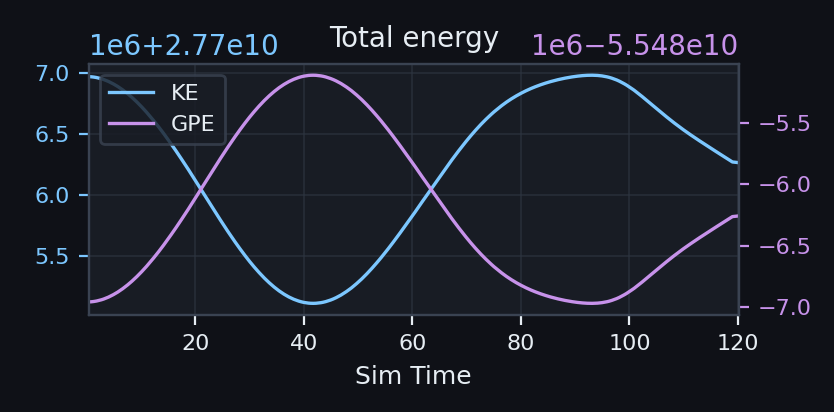
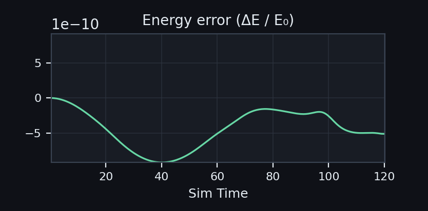
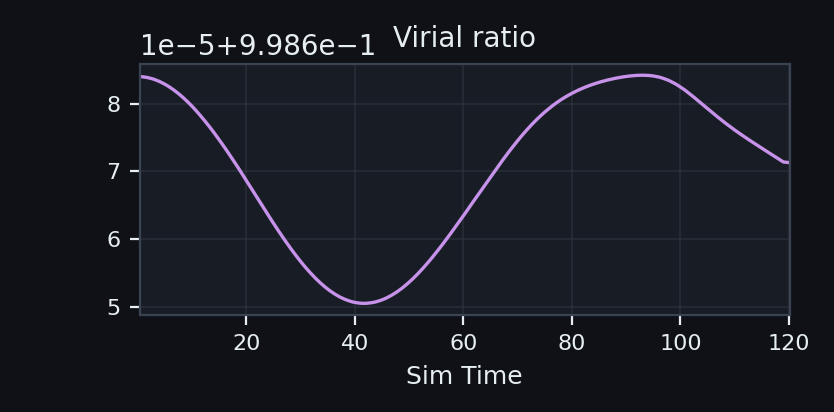

# Orbital Engineer

Orbital Engineer is a GPU-accelerated N-body simulation engine with leapfrog KDK integration, swept collision detection, configurable merging, and bouncing.


## Theory of Operation

A host controller initializes the simulation and dispatches OpenCL kernels. Each tick updates positions and velocities using [leapfrog KDK integration](https://en.wikipedia.org/wiki/Leapfrog_integration).

### Clock Tick

Each tick receives the elapsed time and splits it into steps capped by `DEFAULT_DT_BASE`. Collision handling can shorten these steps further.

### Time Step

Each time step has three phases:

1. **Swept detection:** Estimate the earliest collision and shorten the step when needed to reduce overlap and tunneling. Contact is detected when the gap between body surfaces is at most `EPS_DIST`.
2. **Leapfrog KDK:** Update velocity and position using the selected time step $h$.

   | Step | Operation | Duration | Updates  |
   | ---- | --------- | -------- | -------- |
   | 1    | `KICK`    | $h/2$    | Velocity |
   | 2    | `DRIFT`   | $h$      | Position |
   | 3    | `KICK`    | $h/2$    | Velocity |

   Positions stay fixed during kicks; velocities stay fixed during the drift.

3. **Collision handling:** Apply the behavior selected by each body's flags:

   - **None:** Bodies pass through each other. [Softening](#plummer-softening) limits gravitational forces at close range.
   - **Merge:** Combine bodies at their center of mass with their combined momentum.
   - **Bounce:** Apply a normal impulse controlled by the [coefficient of restitution](#coefficient-of-restitution).

## Velocity and Position at Each Stage

| Stage       | Position             | Velocity                    |
| ----------- | -------------------- | --------------------------- |
| Initial     | $\mathbf r_i^n$      | $\mathbf v_i^n$             |
| First kick  | $\mathbf r_i^n$      | $\mathbf v_i^{n+1/2}$       |
| Drift       | $\mathbf r_i^{n+1}$  | $\mathbf v_i^{n+1/2}$       |
| Second kick | $\mathbf r_i^{n+1}$  | $\mathbf v_i^{n+1}$         |
| Collision   | $\mathbf r_i^{n+1}$  | Post-impact velocity        |

Subscript $i$ identifies a body; superscripts $n$ and $n+1$ mark consecutive states. The intermediate velocity is labeled $n+1/2$. Merging also updates the final position to the group's center of mass.

## Velocity Update (Kick)

- **Related kernel:** [`engine/velocity/*`](/src/orbitalengineer/engine/velocity/)
- **References:**
  - [Newton's law of universal gravitation - Wikipedia](https://en.wikipedia.org/wiki/Newton's_law_of_universal_gravitation)
  - [Plummer softening](#plummer-softening)
- **Complexity:** $O(N^2)$
- **Duration:** $h/2$ per kick

### Velocity Formula

$$
\begin{aligned}
\mathbf a_i^n &= G\sum_{j\ne i} m_j
\frac{\mathbf r_j^n-\mathbf r_i^n}{\left((r_{ij}^n)^2+\epsilon^2\right)^{3/2}}
&& \text{acceleration} \\
\mathbf v_i^{n+1/2} &= \mathbf v_i^n+\frac{h}{2}\mathbf a_i^n
&& \text{first kick} \\
\mathbf v_i^{n+1} &= \mathbf v_i^{n+1/2}+\frac{h}{2}\mathbf a_i^{n+1}
&& \text{second kick}
\end{aligned}
$$

Here:

- $h$ is the full time step.
- $m_j$ is body $j$'s mass, and $G$ is `GRAV_CONSTANT`.
- $r_{ij}^n$ is the distance between bodies $i$ and $j$ at state $n$.
- $\epsilon$ is the [Plummer softening length](#plummer-softening), configured by `SOFTENING_LENGTH`.
- $\mathbf a_i^{n+1}$ is recomputed using all bodies' positions after the drift.

## Position Update (Drift)

- **Related kernel:** [`engine/position/*`](/src/orbitalengineer/engine/position/)
- **Complexity:** $O(N)$
- **Duration:** $h$

### Position Formula

$$
\mathbf r_i^{n+1}=\mathbf r_i^n+h\mathbf v_i^{n+1/2}
$$

The drift advances body $i$'s position by a full time step $h$, using the [half-kicked velocity](#velocity-formula).

## Bouncing Collisions

- **Related kernel:** [`engine/bounce/*`](/src/orbitalengineer/engine/bounce/)
- **References:** [Elastic collision - Wikipedia](https://en.wikipedia.org/wiki/Elastic_collision)
- **Complexity:** $O(N^2)$

### Coefficient of Restitution

The [coefficient of restitution](https://en.wikipedia.org/wiki/Coefficient_of_restitution), $0\le e\le1$, controls the bounce. Set it with `COEF_OF_RESTITUTION`.

- $e=1$: Fully elastic; kinetic energy is conserved.
- $e=0$: No remaining relative motion along the normal. Tangential motion remains, so bodies may slide apart.

### Algorithm

For a colliding pair $(i,j)$ with positive masses, primes denote velocities after the impulse.

1. Compute the separation and unit contact normal, pointing from body $i$ to body $j$:

   $$
   \mathbf d_{ij}=\mathbf r_j-\mathbf r_i,\qquad
   r_{ij}=\lVert\mathbf d_{ij}\rVert,\qquad
   \hat{\mathbf n}_{ij}=\frac{\mathbf d_{ij}}{r_{ij}}
   $$

   Coincident centers require a separately chosen normal.

2. Compute the signed relative velocity along the normal:

   $$
   v_{\mathrm{rel},n}=(\mathbf v_j-\mathbf v_i)\cdot\hat{\mathbf n}_{ij}
   $$

   Apply an impulse only when $v_{\mathrm{rel},n}<0$ (approaching).

3. Compute the nonnegative scalar impulse magnitude:

   $$
   J=-\frac{(1+e)v_{\mathrm{rel},n}}{\frac{1}{m_i}+\frac{1}{m_j}}
   $$

4. Apply equal and opposite impulses:

   $$
   \begin{aligned}
   \mathbf v_i' &= \mathbf v_i-\frac{J}{m_i}\hat{\mathbf n}_{ij} \\
   \mathbf v_j' &= \mathbf v_j+\frac{J}{m_j}\hat{\mathbf n}_{ij}
   \end{aligned}
   $$

For an unconstrained pair, this conserves linear momentum and gives $v_{\mathrm{rel},n}'=-e\,v_{\mathrm{rel},n}$, leaving tangential velocities unchanged.

## Coalescence (Merging)

- **Related kernel:** [`engine/merge/*`](/src/orbitalengineer/engine/merge/)
- **References:** [Coalescence (physics) - Wikipedia](https://en.wikipedia.org/wiki/Coalescence_(physics))

### Algorithm for Coalescence

A pair can merge when one body has `MERGE_AS_PRIMARY` and the other has `MERGE_AS_SECONDARY`.

For a merging group $\mathcal C$, compute its mass, velocity, and position:

$$
\begin{aligned}
M_{\mathcal C} &= \sum_{i\in\mathcal C}m_i
&& \text{combined mass} \\
\mathbf v_{\mathrm{cm}} &= \frac{1}{M_{\mathcal C}}\sum_{i\in\mathcal C}m_i\mathbf v_i
&& \text{combined velocity} \\
\mathbf r_{\mathrm{cm}} &= \frac{1}{M_{\mathcal C}}\sum_{i\in\mathcal C}m_i\mathbf r_i
&& \text{combined position}
\end{aligned}
$$

Merging preserves mass and linear momentum unless fixed-property flags override these updates.

## What Affects Numerical Correctness?

- **Collisions:** Inelastic bounces and merging can reduce mechanical energy.
- **Time step:** Large steps increase integration error, especially during close encounters. Compare smaller steps to check convergence.
- **Adaptive stepping:** Collision handling shortens steps, which can affect long-term energy behavior.
- **Precision:** `USE_DOUBLE_PRECISION` reduces rounding error but may be slower on some GPUs.
- **Compiler settings:** Disable `USE_FAST_RELAXED_MATH` to favor accuracy over speed.

## Measuring Numerical Correctness

Use active bodies and sample positions and velocities after a complete step. Conservation checks assume an isolated system without fixed-body constraints or changes to its membership.

| Symbol | Meaning |
| ------ | ------- |
| $m_i$ | Body mass |
| $\mathbf r_i$ | Body position |
| $\mathbf v_i$ | Body velocity |
| $r_{ij}$ | $\lVert\mathbf r_j-\mathbf r_i\rVert$, Distance between bodies |
| $G$ | `GRAV_CONSTANT` |
| $\epsilon$ | [Plummer softening length](#plummer-softening), `SOFTENING_LENGTH` |

### Kinetic energy

$$
K(t)=\frac{1}{2}\sum_i m_i |\mathbf v_i(t)|^2
$$

Kinetic energy measures motion. It changes as gravity accelerates bodies and is not conserved on its own.

### Gravitational potential energy

$$
U(t)=-G\sum_{i<j}\frac{m_i m_j}{\sqrt{r_{ij}(t)^2+\epsilon^2}}
$$

The [Plummer-softened potential](#plummer-softening) counts each pair once and excludes self-interactions. Use the same [softening](#plummer-softening) as the [kick kernel](#velocity-update-kick); $\epsilon=0$ gives the Newtonian potential.

### Total energy



$$
E(t)=K(t)+U(t)
$$

Kinetic and potential energy exchange during an orbit. Their sum should stay approximately constant under conservative gravity.

> [!IMPORTANT]
> Distinguish collision and merging losses from numerical drift.

### Energy error



$$
\Delta E(t)=E(t)-E_0,\qquad
\delta_E(t)=\frac{E(t)-E_0}{E_0},\qquad E_0=E(0)
$$

The metrics display shows signed relative error $\delta_E$. Its magnitude measures fractional energy change; for $E_0<0$, a positive value means energy became more negative. If $E_0\approx0$, use $\Delta E$ or normalize by $K(0)+|U(0)|$.

**Expected:** Small, bounded oscillations for smooth motion with fixed-step leapfrog. Growing error can indicate large steps, rounding error, or a bug.

### Virial ratio



$$
Q(t)=\frac{2K(t)}{|U(t)|}
$$

For a bound Newtonian system in equilibrium, $2\langle K\rangle+\langle U\rangle=0$. Use velocities relative to the center of mass to assess internal equilibrium. Values away from unity can reflect collapse or expansion rather than a numerical error.

This ratio is undefined at $U=0$. Significant [softening](#plummer-softening) changes the virial relation, so equilibrium need not give $Q\approx1$.

### Linear momentum

> [!NOTE]
> This metric is not currently tracked.

$$
\mathbf P(t)=\sum_i m_i\mathbf v_i(t),\qquad
\Delta\mathbf P(t)=\mathbf P(t)-\mathbf P(0)
$$

Linear momentum should remain constant through gravity, bounces, and merges. Changes can reveal unbalanced forces or impulses.

**Expected:** The center of mass moves at constant velocity $\mathbf P/\sum_i m_i$.

### Angular momentum

> [!NOTE]
> This metric is not currently tracked. The engine will probably need to start tracking spin in order to leverage this.

$$
\mathbf L(t)=\sum_i \mathbf r_i(t)\times m_i\mathbf v_i(t)
$$

For the engine's planar motion, this reduces to the signed component perpendicular to the plane:

$$
L_z(t)=\sum_i m_i\left(x_i v_{y,i}-y_i v_{x,i}\right)
$$

**Expected**: Orbital angular momentum should remain constant under central forces when measuring about a fixed inertial origin.

## Plummer Softening

Plummer softening replaces the separation $r$ in the gravitational potential with $\sqrt{r^2+\epsilon^2}$, where $\epsilon$ is `SOFTENING_LENGTH`. This keeps gravity finite at coincident positions and reduces numerical errors during close encounters. Larger values smooth small-scale interactions more strongly; at distances much larger than $\epsilon$, gravity approaches the Newtonian result. Use the same value in force and energy calculations.

See [gravitational softening as a smoothing operation](https://academic.oup.com/mnras/article/425/2/1104/1188012) for background.

## Performance

The following setup simulated roughly 5,000–8,000 bodies in real time:

| Setting | Value |
| ------- | ----- |
| Hardware | AMD Radeon 890M |
| Integration | `EPS_TIME=1e-3`, base step of `1/15` |
| Bouncing | Enabled; restitution coefficient `0.98` |
| Merging | Disabled |
| Scenario | 5,000–8,000 secondary bodies orbiting a massive central body |
| Utilization | About 90% GPU and 20% host CPU |

Collision handling adapts the time step. No kernel bottlenecks were observed in this setup.

## Apps

### Orbital Engineer Server

The server manages the N-body engine:

- Receives client commands over a socket.
- Dispatches simulation ticks and steps.
- Copies orbital state from GPU memory to shared memory.
- Sends kernel metrics over an IPC socket.

A client must send commands to run the simulation.

### User Interface Client App

The UI builds scenarios, sends server commands, and displays orbital state from shared memory.

### App Interactions

    ┏━━━━━━━━━┓     ╭───────────╮                        ╭───────╮
    ┃         ┃     │           ├──── OpenCL kernels ────│  GPU  │
    ┃ SERVER  ┃     │ ORBITAL   │                        ╰───────╯
    ┃         ┃     │ ENGINEER  │
    ┃         ┃     │ (library) │                        ╭───────╮
    ┃         ┃┄┄┄┄┄│           ├──── NumPy kernels ─────│  CPU  │
    ┃         ┃     ╰───────────╯                        ╰───────╯
    ┃         ┃
    ┃         ┃
    ┃         ┃                                  ╭───────────────╮
    ┃         ┃──── write state vectors ───────>>│               │
    ┗━━━━━━━━━┛                                  │ SHARED MEMORY │
         │                                       │               │
         │                                       │ - position    │
     IPC socket                                  │ - velocity    │
     connection                                  │ - mass        │
         │                                       │ - radius      │
         │                                       │ - flags       │
    ┏━━━━━━━━━┓                                  │ - force (N,N) │
    ┃         ┃<<─── read state vectors ─────────│               │
    ┃   GUI   ┃                                  ╰───────────────╯
    ┃         ┃
    ┗━━━━━━━━━┛

## Analyzing Metrics


The metrics app displays kernel timings and energy diagnostics. Start it from the repository root:

```bash
./.venv/bin/python src/ui_metrics/metrics_app.py
```

Set `ENABLE_PROFILING = True` (the default) to enable profiling and metrics. The engine sends metrics to `METRIC_SOCKET_PATH`. Profiling may add some overhead.

## IPC Message Transport Protocol

Client–engine messages use a binary header and a JSON payload with a defined schema. See the [protocol reference](docs/transport-protocol.md).

## Development

1. Install the system OpenCL dependencies. For AMD GPUs on Arch Linux:

   ```bash
   sudo pacman -Syu rocm-opencl-runtime
   ```

2. Create the virtual environment:

   ```bash
   make venv
   ```

3. Install the engine in that environment:

   ```bash
   ./.venv/bin/python -m pip install -e .
   ```
